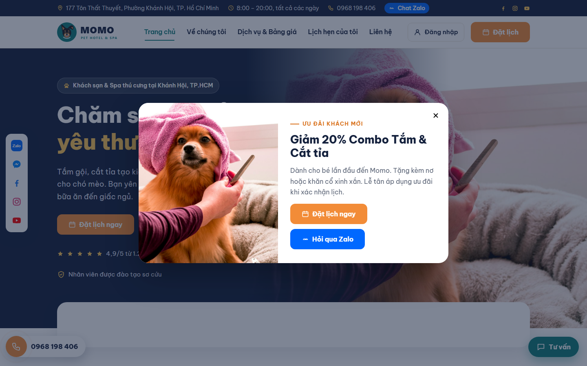
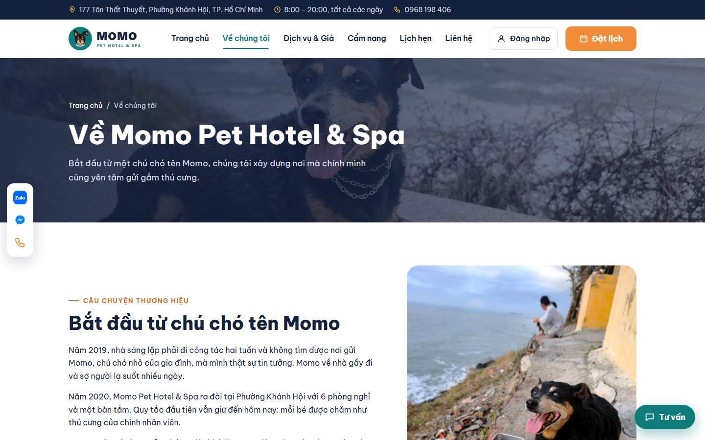
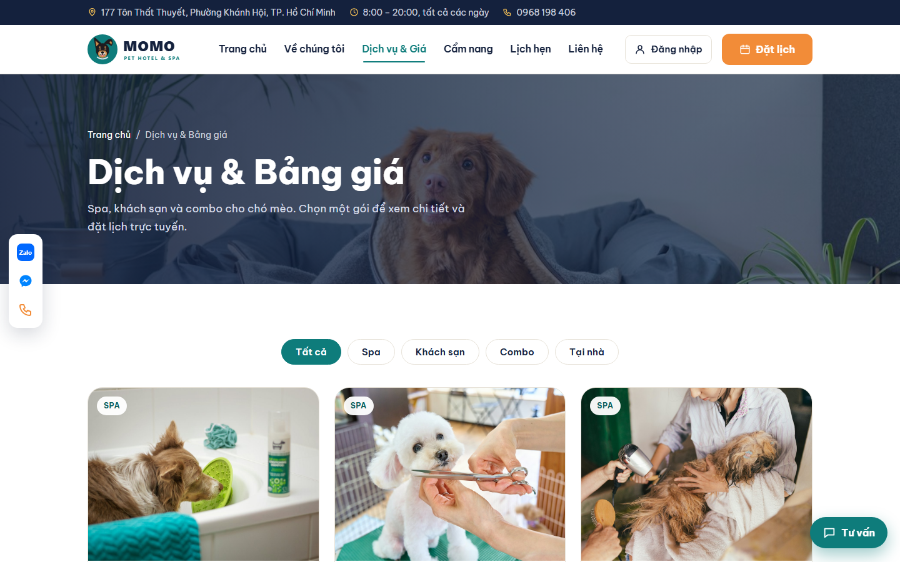
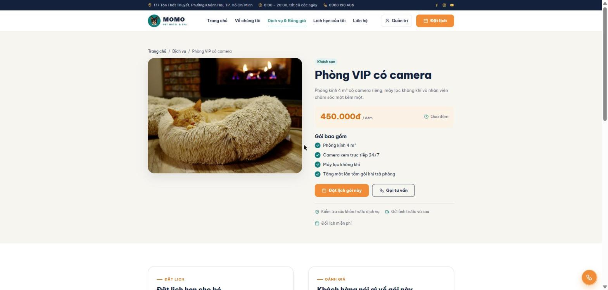
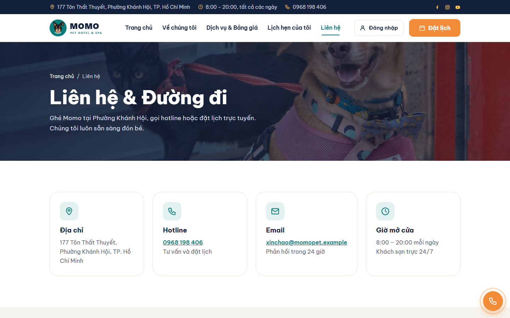
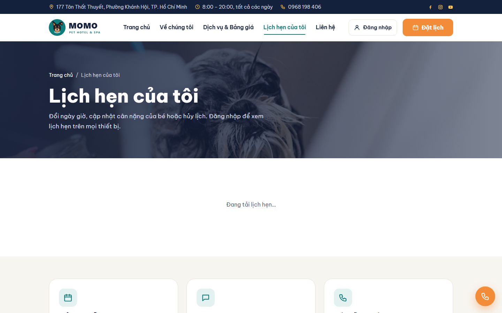
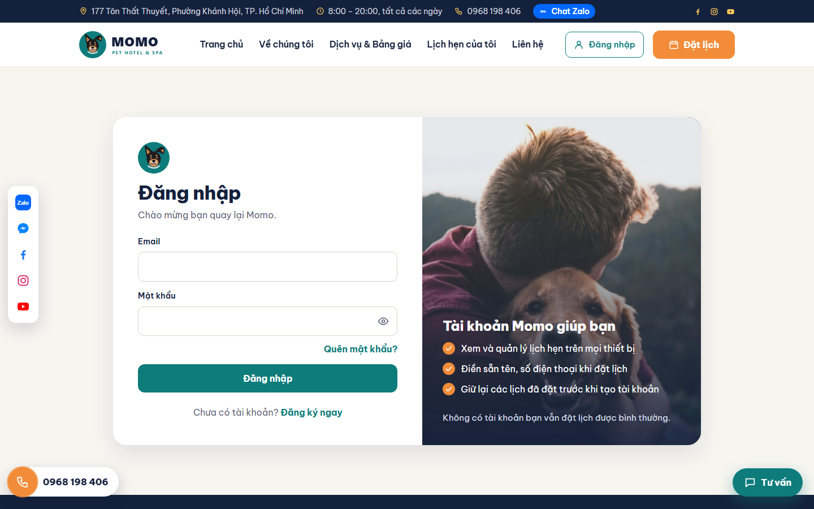
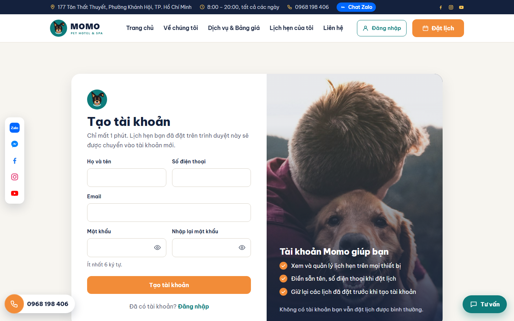
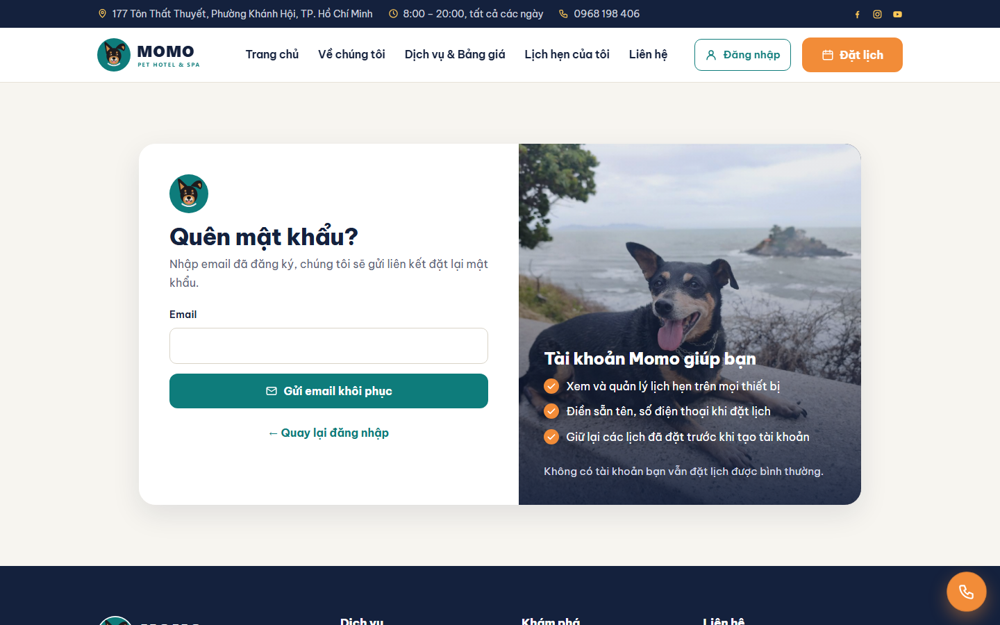
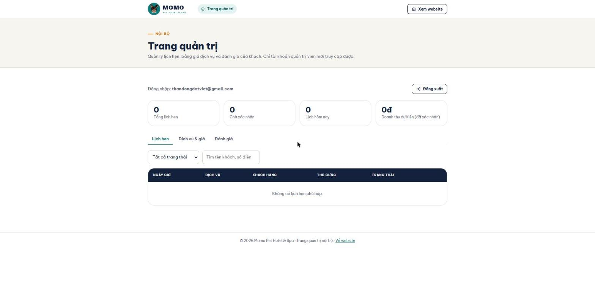

# BÁO CÁO BÀI THI CUỐI KHÓA — AI VIBE CODING

## Website Momo Pet Hotel & Spa

| | Liên kết |
|---|---|
| Website (GitHub Pages) | https://mazsupilami.github.io/momo-pet-hotel-spa/ |
| Mã nguồn (GitHub, Public) | https://github.com/mazsupilami/momo-pet-hotel-spa |
| Facebook | https://www.facebook.com/profile.php?id=61597136690392 |
| Instagram | https://www.instagram.com/momo_suteki/ |
| YouTube | https://www.youtube.com/@MomoPetHotelSpa |

---

## 1. Mô tả dự án

- **Lĩnh vực**: khách sạn và spa chăm sóc thú cưng (chó, mèo): tắm gội, cắt tỉa, phòng lưu trú có camera, trông giữ ban ngày.
- **Thương hiệu**: **Momo Pet Hotel & Spa**, thương hiệu **hư cấu** tạo riêng cho bài thi. Chọn chủ đề thú cưng để khác với các bài bán quần áo, đồ ăn thường gặp.
- **Câu chuyện**: tiệm ra đời từ Momo, chú chó của gia đình người làm bài. Địa chỉ: 177 Tôn Thất Thuyết, Phường Khánh Hội, TP. Hồ Chí Minh (theo đơn vị hành chính mới). Hotline 0968 198 406.
- **Logo**: được **tạo trước** khi dựng trang, vẽ bằng SVG theo dáng Momo thật (lông đen vện vàng, một tai dựng một tai cụp, lè lưỡi, vòng xích bạc). Mọi trang, favicon, Facebook, Instagram, YouTube đều dùng đúng logo này.
  - `assets/img/logo.svg` (nền sáng), `assets/img/logo-light.svg` (nền tối), `assets/img/logo-mark.svg` (favicon, ảnh đại diện mạng xã hội).
- **Công nghệ**: HTML, CSS, JavaScript thuần (không framework); **Supabase** (PostgreSQL + Auth) làm database; **GitHub Pages** để deploy.
- **Ảnh**: ảnh chụp thật từ Unsplash, Pexels (miễn phí bản quyền) và ảnh thật của chú chó Momo.

## 2. Các trang trong dự án

Website có 12 trang. Tất cả các trang khách dùng chung header (menu) và footer, nên trang nào cũng dẫn được tới các trang còn lại.

| # | Trang | File | Nội dung chính |
|---|---|---|---|
| 1 | **Trang chủ** | `index.html` | Banner, số liệu, dịch vụ nổi bật (đọc từ database), lý do chọn Momo, quy trình 4 bước, **video YouTube**, đánh giá khách hàng, thư viện ảnh, hỏi đáp |
| 2 | **Về chúng tôi** | `about.html` | Câu chuyện Momo, mốc thời gian, cơ sở vật chất, đội ngũ, **bảng giá** (từ database), **video giới thiệu của shop trên YouTube** |
| 3 | Dịch vụ & Bảng giá | `services.html` | Toàn bộ gói dịch vụ từ database, lọc theo nhóm Spa / Khách sạn / Combo |
| 4 | **Chi tiết dịch vụ** | `service.html?id=…` | Thông tin gói, giá, **form đặt lịch**, đánh giá của khách |
| 5 | Lịch hẹn của tôi | `bookings.html` | Xem, **sửa**, **hủy** lịch hẹn |
| 6 | Liên hệ | `contact.html` | Địa chỉ, giờ mở cửa, hotline, **Google Map** |
| 7 | Đăng nhập | `login.html` | Một trang đăng nhập chung cho khách và admin |
| 8 | Đăng ký | `register.html` | Tạo tài khoản khách |
| 9 | Quên mật khẩu | `forgot-password.html` | Gửi email khôi phục mật khẩu |
| 10 | Đặt lại mật khẩu | `reset-password.html` | Mở từ liên kết trong email |
| 11 | Tài khoản của tôi | `account.html` | Sửa họ tên, số điện thoại, đổi mật khẩu, đăng xuất |
| 12 | Quản trị | `admin.html` | Giao diện riêng cho admin |

| Trang chủ | Về chúng tôi |
|---|---|
|  |  |

| Dịch vụ | Chi tiết dịch vụ |
|---|---|
|  |  |

| Liên hệ (Google Map) | Lịch hẹn của tôi |
|---|---|
|  |  |

| Đăng nhập | Đăng ký |
|---|---|
|  |  |

| Quên mật khẩu | Quản trị |
|---|---|
|  |  |

## 3. Các chức năng được thực hiện

### 3.1. Database Supabase

| Bảng | Dùng cho |
|---|---|
| `services` | 9 gói dịch vụ, giá, ảnh (dữ liệu gốc: `data/services.csv`) |
| `bookings` | Lịch hẹn của khách, có trạng thái chờ xác nhận / đã xác nhận / hoàn thành / đã hủy |
| `reviews` | Đánh giá của khách cho từng gói |
| `profiles` | Họ tên, số điện thoại của khách có tài khoản |
| `admins` | Danh sách tài khoản quản trị |

Mã tạo bảng và quy tắc bảo mật (Row Level Security) nằm trong `supabase/schema.sql` và `supabase/auth_admin.sql`. Khách chỉ đọc và sửa được dữ liệu của chính mình; quyền admin kiểm tra bằng hàm `is_admin()` trong database.

### 3.2. Chức năng chỉnh sửa database (insert, update, delete)

| Chức năng | Thao tác | Bảng | Ở đâu |
|---|---|---|---|
| Đặt lịch hẹn | **INSERT** | `bookings` | Chi tiết dịch vụ |
| Sửa ngày giờ, cân nặng thú cưng, ghi chú | **UPDATE** | `bookings` | Lịch hẹn của tôi |
| Hủy lịch hẹn | **DELETE** | `bookings` | Lịch hẹn của tôi |
| Gửi đánh giá | **INSERT** | `reviews` | Chi tiết dịch vụ |
| Đăng ký, sửa thông tin tài khoản | **INSERT / UPDATE** | `profiles` | Đăng ký, Tài khoản của tôi |
| Admin đổi trạng thái lịch hẹn | **UPDATE** | `bookings` | Quản trị |
| Admin xóa lịch hẹn, xóa đánh giá | **DELETE** | `bookings`, `reviews` | Quản trị |
| Admin sửa giá, chọn dịch vụ nổi bật | **UPDATE** | `services` | Quản trị |
| Admin tạo lịch hộ khách gọi hotline | **INSERT** | `bookings` | Quản trị, tab Tạo lịch hẹn |

### 3.3. Tài khoản và quản trị

- Khách **không bắt buộc** đăng nhập để đặt lịch (Supabase cấp phiên ẩn danh). Khi tạo tài khoản, các lịch đã đặt được giữ lại.
- Một trang đăng nhập chung: admin đăng nhập xong vào trang Quản trị, khách vào trang Tài khoản.
- Nút mắt hiện/ẩn mật khẩu ở mọi ô mật khẩu; trang Đăng ký kiểm tra hai mật khẩu khớp nhau.
- Khôi phục mật khẩu qua email (`resetPasswordForEmail`).
- Trang Quản trị: thống kê (tổng lịch, chờ xác nhận, lịch hôm nay, doanh thu dự kiến), tìm kiếm và lọc lịch hẹn, đổi trạng thái, xóa; tạo lịch hộ khách gọi hotline; sửa giá dịch vụ; xóa đánh giá.
- Phân vai rõ ràng: admin không dùng form đặt lịch và form đánh giá của khách (lịch sẽ gắn sai tài khoản, đánh giá phải là của khách). Thay vào đó admin thấy thông báo và nút sang trang Quản trị.

### 3.4. Nhúng

- **Video YouTube** ở Trang chủ (quy trình grooming) và ở trang Về chúng tôi (video giới thiệu của chính shop).
- **Google Map** ở trang Liên hệ, trỏ đúng 177 Tôn Thất Thuyết, có nút Chỉ đường.

### 3.5. Khác

- Giao diện đáp ứng điện thoại (menu ☰, lưới 1 cột), nút gọi hotline nổi.
- Facebook Page, Instagram, kênh YouTube của shop với logo, ảnh bìa, bài đăng, video; website liên kết tới cả ba.

### 3.6. Kết quả kiểm thử (25/11/2026)

| Kiểm thử | Kết quả |
|---|---|
| Khách ẩn danh đặt lịch, sửa, hủy (trên máy và trên GitHub Pages) | Đạt |
| Đăng ký tài khoản, lịch đặt trước được giữ lại | Đạt |
| Đăng nhập sai mật khẩu báo lỗi tiếng Việt; đăng nhập đúng | Đạt |
| Sửa họ tên, số điện thoại; form đặt lịch tự điền | Đạt |
| Khách mở trang Quản trị bị chặn; khách tự đổi trạng thái lịch bị database chặn | Đạt |
| Admin đổi trạng thái, sửa giá, xóa lịch, xóa đánh giá | Đạt |
| Gửi email khôi phục mật khẩu (Supabase ghi nhận `mail.send`) | Đạt |
| 12 trang trên GitHub Pages trả về 200, không tràn ngang trên điện thoại | Đạt |

## 4. Các file .md và chức năng

| File | Chức năng |
|---|---|
| `PRD.md` | **Product Requirements Document**: mô tả thương hiệu, người dùng, các trang, danh sách chức năng và thao tác database. AI đọc file này trước khi code để làm đúng và đủ yêu cầu, không làm thừa. |
| `DESIGN.md` | **Quy chuẩn giao diện**: màu sắc (biến CSS), font, bố cục chung, thành phần, icon, logo, ảnh. AI đọc file này mỗi khi sửa giao diện để mọi trang nhất quán. |
| `DATABASE.md` | Thiết kế các bảng, cột, quy tắc bảo mật, hàm truy vấn trong `db.js`, các bước cài đặt Supabase. |
| `CLAUDE.md` | Quy tắc cho AI (Claude Code) khi làm việc trong dự án; được tự đọc ở đầu mỗi phiên: đường dẫn tương đối, header/footer chung, không đưa mật khẩu lên repo, ghi nhật ký prompt… |
| `PROMPTS.md` | Nhật ký toàn bộ prompt theo thứ tự và kết quả của từng prompt. |
| `README.md` | Giới thiệu dự án, link website, cấu trúc thư mục, cách chạy trên máy. |
| `BAOCAO.md` | Báo cáo này. |

## 5. Thứ tự các prompt và kết quả

Chi tiết từng prompt ở **[PROMPTS.md](PROMPTS.md)**. Tóm tắt:

| # | Prompt | Kết quả chính |
|---|---|---|
| 1 | Đọc đề thi, đề xuất phương án, kế hoạch | Phân tích thang điểm và lỗi trừ điểm, chọn HTML/JS + Supabase + GitHub Pages |
| 2 | Chọn thương hiệu hư cấu | Bản nháp thương hiệu cà phê (sau đó được thay) |
| 3 | Đổi sang Momo Pet Hotel & Spa | Logo, file .md, CSV, schema Supabase, 6 trang, đặt/sửa/hủy lịch, nhúng Map và YouTube |
| 4 | Chuyển folder, kết nối Supabase, dùng ảnh thật | Kết nối database, 20 ảnh thật, thiết kế lại |
| 5 | Momo là chó, địa chỉ thật, giao diện chuyên nghiệp | Logo chó, giao diện thương mại, địa chỉ và bản đồ mới |
| 6 | Địa danh mới, hotline thật, mạng xã hội, đăng nhập, Admin | Phường Khánh Hội, hotline thật, tài khoản khách, trang Quản trị |
| 7 | Ảnh thật của Momo | Vẽ lại logo theo Momo, đưa ảnh Momo vào website |
| 8 | Tạo Facebook Page | Page có logo, ảnh bìa, thông tin, 3 bài đăng |
| 9 | Tách giao diện Admin, gộp đăng nhập | Header riêng cho Admin, phân luồng theo vai trò |
| 10 | Hiện mật khẩu, tách Đăng nhập/Đăng ký, khôi phục mật khẩu | 4 trang xác thực mới, nút mắt, email khôi phục |
| 11 | Instagram, YouTube, test toàn bộ, deploy | Test đạt, deploy GitHub Pages, Instagram 3 bài, YouTube ảnh bìa + video, báo cáo này |
| 12 | Admin đăng nhập vẫn đặt lịch được, có đúng không? | Ẩn form đặt lịch/đánh giá với admin, thêm tab Tạo lịch hẹn hộ khách trong Quản trị |

## Đối chiếu tiêu chí chấm

| Tiêu chí | Điểm | Đáp ứng |
|---|---|---|
| Ít nhất 3 trang: Trang chủ, Về chúng tôi, Chi tiết | 3 | 12 trang, có đủ 3 trang bắt buộc |
| Database CSV / SQLite / Supabase | 3 | Supabase 5 bảng + `data/services.csv` |
| Ít nhất 2 chức năng chỉnh sửa database | 2 | Insert, update, delete trên `bookings`, `reviews`, `profiles`, `services` |
| Nhúng Google Map hoặc YouTube | 0,5 | Cả Google Map và 2 video YouTube |
| Sử dụng file .md | 0,5 | 7 file .md |
| Push GitHub, để Public | 0,5 | https://github.com/mazsupilami/momo-pet-hotel-spa |
| Deploy | 0,5 | https://mazsupilami.github.io/momo-pet-hotel-spa/ |
| Các trang liên kết với nhau | — | Header và footer chung trên mọi trang |
| Thương hiệu hư cấu phải tạo logo trước và dùng đúng logo | — | Logo SVG tạo trước, dùng thống nhất trên website và mạng xã hội |
